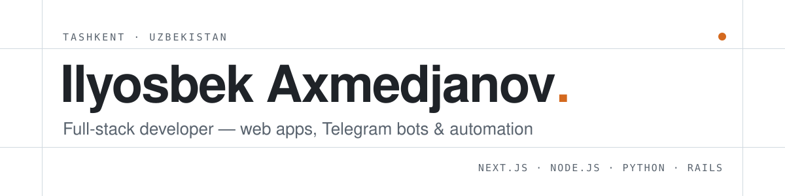

<picture>
  <source media="(prefers-color-scheme: dark)" srcset="assets/banner-dark.svg">
  
</picture>

I build web products end to end: interfaces in **React / Next.js**, APIs in **Node.js, Python and Ruby on Rails**, shipped with **Docker**. Lately most of my work is business tooling — company sites, Telegram bots, AI auto-replies and internal dashboards for clients in Uzbekistan.

Right now I'm building **[Cresta Systems](https://cresta.uz)** — a small studio that makes websites, Telegram bots and automation for local businesses.

### Selected work

| Project | What it is | Stack |
|---|---|---|
| [**Cresta Systems**](https://cresta.uz) | Studio website — services, portfolio, pricing; three languages | Next.js · TypeScript · Tailwind |
| [**Turkcha–O'zbekcha**](https://turkcha-uzbekcha.vercel.app) | Turkish ↔ Uzbek learning platform | JavaScript |
| [**Uzbekistan Weather**](https://uzbekistan-weather.vercel.app) | Forecasts for every region of Uzbekistan | TypeScript · React |
| [**Crypto Portfolio**](https://crypto-portfolio-dashboard-tan.vercel.app) | Portfolio tracker with live prices and charts | TypeScript · Next.js |
| [**Admin Dashboard**](https://admin-dashboard-steel-eta-36.vercel.app) | Admin panel with tables, filters and charts | TypeScript · Next.js |
| [**Bug'doy Bakery**](https://theilyostv.github.io/bugdoy-bakery/) | Bakery site with a cart that sends orders to Telegram | HTML · CSS · JS |

### Stack

### Contact

[Telegram](https://t.me/ilyosbek_axmedjanov) · [Instagram](https://instagram.com/ilyosbek_axmedjanov) · [YouTube](https://youtube.com/@ilyosbek_dev) · [theilyostv@gmail.com](mailto:theilyostv@gmail.com)

Open to freelance projects and full-time roles.
