I build web products end to end — interfaces in **React / Next.js**, APIs in **Node.js, Python and Ruby on Rails**, shipped with **Docker**. Most of my work today is business tooling for clients in Uzbekistan: company websites, Telegram bots, AI auto-replies and internal dashboards.

  
  

  
  

  
  

Building **[Cresta Systems](https://cresta.uz)** — a small studio that makes websites, Telegram bots and automation for local businesses. Open to freelance projects and full-time roles.

  <a href="mailto:theilyostv@gmail.com"><b>Email</b></a> ·
  <a href="https://t.me/ilyosbek_axmedjanov"><b>Telegram</b></a> ·
  <a href="https://instagram.com/ilyosbek_axmedjanov"><b>Instagram</b></a> ·
  <a href="https://youtube.com/@ilyosbek_dev"><b>YouTube</b></a> ·
  <a href="https://ilyosdev.uz"><b>Portfolio</b></a> ·
  <a href="https://cresta.uz"><b>cresta.uz</b></a>

